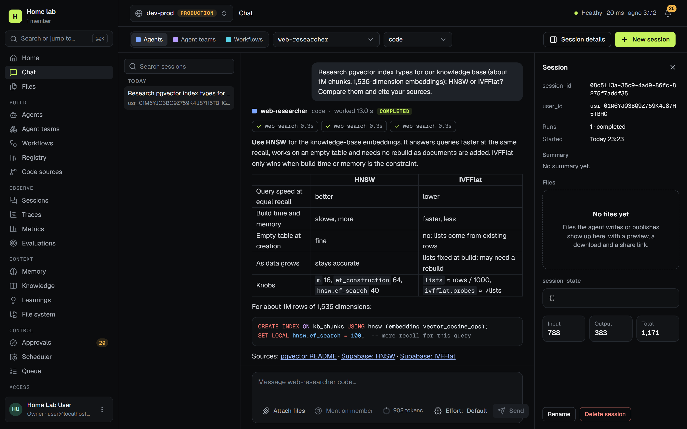

# Agnostic

A self-hosted control plane for [Agno](https://github.com/agno-agi/agno)


[](LICENSE)

[Quick start](#quick-start) · [Development](#development) · [Documentation](docs/README.md)



## Features

- Chat with agents, teams and workflows, with streaming tool calls, inline approvals and durable runs
- Coding agents (Pi, OpenCode) that run in a Docker or E2B sandbox per session
- Traces, metrics, cost from your own price table, and evaluations that gate publishing
- Sign-in through your IdP (OIDC, SAML, GitHub), roles per instance, SCIM, service accounts and temporary access
- An editor for agents, teams and workflows, synced with git as pull requests
- An audit log with a hash chain, SIEM streaming and an archive
- One container image. No telemetry, no SaaS, and air-gapped installs are supported

### Prerequisites

| Tool | Version | Notes |
|---|---|---|
| [uv](https://docs.astral.sh/uv/) | 0.13.6 | installs Python 3.15.2 (control plane) and 3.13 (reference runtime) |
| Node.js | 26.13.0 (Active LTS, `.nvmrc`) | 24.11+ works for local development |
| Yarn | 4.18.1 | bundled in `frontend/.yarn/releases` |
| Docker | Compose v2 | PostgreSQL, Redis, Mailpit and coding sandboxes; optional with SQLite |
| [just](https://just.systems) | 1.59.0 | `uv tool install rust-just==1.59.0` |

## Quick start

```bash
git clone https://github.com/Relrin/agnostic.git && cd agnostic

just setup      # .env, then Python and Node dependencies from the lockfiles
just up         # PostgreSQL 18 (+pgvector), Redis 8, Mailpit and a Slack mock
just migrate    # the kernel and every installed module
just bootstrap  # the org "Localhost Company" and its Owner (credentials in .env)
just dev        # API + worker on :8000, web app on :5173
```

Open <http://localhost:5173> and sign in as the Owner. Then give it something to manage:

```bash
just runtimes   # two reference AgentOS instances: dev-prod (:7777) and dev-staging (:7778)
just seed       # connect them; restart `just runtimes` once, then run `just seed --test`
```

The reference runtimes think with an offline mock model, so chat, tool calls and approvals work without an API key.
Ask the web researcher to *research* something, or the Pi coder to *fix* a bug, to see a longer run.

### No Docker? Run on SQLite

Set `AGNOSTIC_DATABASE__URL=sqlite:///agnostic.db` in `.env`, then `just migrate && just bootstrap && just dev`. Jobs
run inside the API process in this mode ([configuration](docs/how-to/configuration.md)).

### A different org or Owner

```bash
cd backend && uv run agnostic bootstrap --org-name "Home lab" --owner-email you@example.com
```

Without `--owner-email` it prints a one-time setup link instead. For GitHub, GitLab, Google, Okta or any OIDC or SAML
provider, see [sign-in providers](docs/how-to/sign-in-providers.md).

## Development

```bash
just check      # lint, types, unit + integration tests, API client drift, licenses
just test-ui    # Storybook a11y tests and Playwright e2e
just --list     # everything else
```

Every dependency is pinned exactly, both sides type-check in strict mode, and module boundaries are checked in CI.
See [CONTRIBUTING](CONTRIBUTING.md), [testing](docs/how-to/testing.md) and
[troubleshooting](docs/how-to/troubleshooting.md).

| Path | What it is |
|---|---|
| `backend/` | uv workspace: `packages/` (kernel, AgentOS client, CEL, codegen, spec), `modules/` (one per feature), `apps/agnostic-server` |
| `frontend/` | Yarn workspaces: the `apps/web` shell, shared `packages/`, feature `modules/` |
| `runtime/` | `agnostic-runtime`, the reference AgentOS: demos, contract tests, a template to start from |
| `bridge/` | `agnostic-bridge`, the optional package for your AgentOS |
| `deploy/`, `scripts/` | Compose files; seed, license, upgrade and restore tooling |
| `docs/` | architecture, decisions, how-to and admin guides, reference |

## License

BSD 3-Clause. See [LICENSE](LICENSE).
