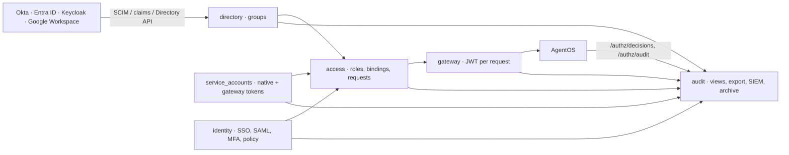

# Access governance

Who can do what, how that is administered at enterprise scale, and how every decision is recorded. This builds on
[identity, access and the gateway](identity-access-gateway.md): the same effective-scope engine, now fed by groups,
editable roles, service accounts and temporary grants, with identity providers keeping people and groups in sync and
an audit log that can be searched, exported, streamed and archived.

## Modules

| Module | Owns | Tables |
|---|---|---|
| `directory` | groups (manual and IdP-synced), SCIM 2.0 server, mapping rules, Google Workspace sync, deprovisioning, the reconcile job | `dir_groups`, `dir_group_members`, `dir_scim_tokens`, `dir_scim_sync_state`, `dir_scim_users`, `dir_mapping_rules`, `dir_google_sync`, `dir_settings` |
| `access` | editable, versioned access roles; bindings for people, groups and service accounts; temporary access requests; the expiry job | adds `access_role_versions`, `access_temp_grant_requests` |
| `identity` | database-managed sign-in providers (OIDC and SAML 2.0), the auth policy (enforce SSO, break-glass, session lifetime, MFA policy), TOTP and WebAuthn, step-up | adds `identity_login_providers`, `identity_auth_policy` |
| `service_accounts` | org-level machine identities, native AgentOS tokens per instance, gateway tokens with rotation, last-used polling | `sa_accounts`, `sa_instance_tokens`, `sa_gateway_tokens` |
| `audit` | saved views, search, export, hash chain, retention policy and S3 archive, SIEM sinks | adds `audit_saved_views`, `audit_exports`, `audit_policy`, `audit_archives`, `audit_sinks`, `audit_sink_cursors`, `audit_ingest_cursors` |
| `gateway` | service-account principals, the `gateway.ingest_authz` job that reads AgentOS authorization logs | — |

Upward calls go through ports implemented by the higher module: identity's `ExternalGroupsSync` (directory) and
`BearerPrincipalResolver` (service_accounts), org's `GroupDirectory` (directory), and directory's `AccessRevoker`
(access).

## Effective access

Effective scopes for a person on an instance are the union of their own bindings, the bindings of every group they
are in, and their org role's implicit access; a service account has only its own bindings. Each grant remembers the
group it came through, so explanations read "Granted by Operator via Support AI → `agents:run` on prod-agentos".
Effective access is cached for 60 s under the access generation, which every change to bindings, roles, groups and
group membership bumps: a role edit reaches every holder on their next request, with no redeploy.

## Roles

Built-in roles (Instance admin, Operator, Builder, Viewer, Auditor) are seeded once and then edited like custom
roles; "Reset" restores the shipped definition. A role is a permission matrix (`{resource: [actions]}`) validated
against the scope catalog, an optional per-component run scope ("Selected agents"), and the instances it may be
bound on. Each save is a new version (`access_role_versions`) and an audit event `roles.update` whose diff lists the
token scopes added and removed. `POST /api/v1/access/roles/{id}/preview` answers "what happens if I save": the diff,
the people, groups and service accounts affected, and warnings for scopes an instance's AgentOS version doesn't
know. A role can't be deleted while it is bound; the 409 lists the bindings.

## Groups and identity providers

| IdP | People | Groups |
|---|---|---|
| Okta, Entra ID | SCIM push (`/scim/v2/Users`) | SCIM push (`/scim/v2/Groups`) |
| Keycloak (or any IdP with a groups claim) | OIDC/SAML sign-in, JIT or invitation | `groups` claim or SAML attribute at every sign-in |
| Google Workspace | OIDC sign-in | Directory API sync every 15 minutes (read-only service account, domain-wide delegation) |
| None | local accounts, invitations | manual groups |

**Mapping rules** carry IdP groups into manual groups ("Okta `support-ai` → Support AI"), so bindings and approval
routes can stay on groups people curate. **Deprovisioning** (SCIM `active=false` or DELETE, a suspended Google
user) sets the account to deprovisioned, ends its sessions, removes its bindings and group memberships; with the
"remove" behaviour it also leaves the org. The only active Owner can't be deprovisioned. Groups can also be approval
route targets ("Approvals routed here" on the group).

## Sign-in policy

Providers are configured in the app (Organization › Authentication) or, read-only, through settings. SAML uses a
small service provider: HTTP-Redirect AuthnRequests, a signed Response or Assertion checked with `signxml`,
audience, recipient, validity window, `InResponseTo` and replay protection. **Enforce SSO** disables passwords for
everyone except one break-glass Owner, whose every password sign-in is audited and announced to Owners. The **MFA
policy** applies to password sign-ins (`optional`, `required_local`, `required_admins`); SSO relies on the IdP's own
MFA. Sensitive changes (sign-in settings, privileged service accounts, removing a factor) need a recent
authentication: the API answers `403 reauth_required` and the app asks the person to confirm it's them.

## Service accounts

| Token | Validated by | Rotation |
|---|---|---|
| Native `agno_pat_…`, one per instance | AgentOS (`/service-accounts`) | revoke and recreate under the same name (a short gap) |
| Gateway `agn_pat_…` | Agnostic (hashed with a pepper); the gateway mints a JWT per request | a new token; the old one keeps working for 24 h |

Gateway JWTs carry `sub = svc_<name>` (AgentOS reserves `sa:` subjects) and `agnostic.principal = "sa:<name>"`. Unless
the account forwards user ids, `user_id` is stripped from requests so runs are attributed to the account. Scoped
service accounts can't resolve approvals; the gateway denies it with an explanation. Privileged scopes need an
explicit confirmation and a recent authentication, and Owners are notified. See
[ADR-011](../adr/0011-service-account-tokens.md).

## Temporary access

Members ask for a role or scopes on an instance for a number of hours ("Request access" next to anything they can't
do); approvers are Owners, Administrators and owners of a group that already has that access there. Approval creates
an expiring binding; `access.expire_bindings` removes it when it lapses and closes the request. Admins can grant
temporary access directly from the audit log ("Grant temporary access…"). The longest duration is the org setting
`temporary_access_max_hours` (168).

## Audit log

- **Search and views**: filters by actor, action, decision, instance, date, source (Agnostic or AgentOS), plus text
  search over resource, request id and IP; saved views are personal or shared and show capped counts.
- **Denials** keep the explanation the person saw (`denial_reason`); the detail offers temporary access.
- **Export**: CSV or JSONL, streamed up to 10 000 rows, otherwise as a background job (kept 24 h).
- **SIEM**: HTTPS webhooks (HMAC-SHA256 in `X-Agnostic-Signature: t=…,v1=…`), syslog (RFC 5424 over TCP/TLS) and
  OTLP/HTTP logs, as JSON, OCSF or CEF. Delivery is at least once: a cursor per sink advances only after the
  destination accepted the batch. See [SIEM streaming and the audit archive](../how-to/audit-siem-and-archive.md).
- **Retention and archive** ([ADR-017](../adr/0017-audit-retention-tiers.md)): events stay in PostgreSQL for the
  hot window (400 days); with the archive on, each expiring month is written to S3-compatible storage as
  JSONL.zst with a manifest (event count, SHA-256, chain head), read back and verified, and only then dropped.
  "Restore for search" brings a month back for 7 days.
- **Hash chain** (optional): each event's hash covers the previous one; `agnostic audit verify` checks a range.
- **AgentOS ingestion**: `/authz/decisions` and `/authz/audit` of instances that record them, so direct native-token
  and JWT traffic appears with `source = agentos`.
