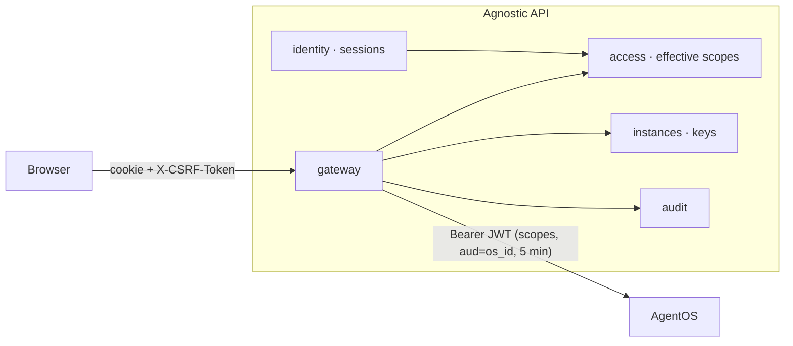

# Identity, access and the gateway

Phase 1 gives the control plane its spine: people sign in, belong to the installation's one org with an org role,
connect AgentOS instances with per-instance keys, and call any AgentOS route through the gateway with a JWT that
carries exactly their scopes. Every change and every denial is audited.

## Modules

| Module | Owns | Tables |
|---|---|---|
| `audit` | append-only event store, action vocabulary, write API (`AuditLog.record` / `record_now`), list API, retention | `audit_events` (monthly partitions on PostgreSQL) |
| `settings` | org settings: `require_explicit_bindings`, `audit_log_all_reads` | `settings_org`, `settings_flags` |
| `identity` | accounts, argon2id passwords, web sessions + CSRF, SSO (OIDC and GitHub), password reset, `/me` | `identity_users`, `_credentials`, `_external_identities`, `_sessions`, `_preferences` |
| `instances` | registry, discovery, diagnostics, RS256 key pairs (sealed), JWKS, health polling, `/config` snapshots, capability matrix | `inst_instances`, `_snapshots`, `_capabilities`, `_jwt_keys` |
| `org` | the org profile, members with org roles, invitations, seats, `agnostic bootstrap` | `org_profile`, `org_members`, `org_invitations` |
| `access` | scope catalog, built-in access roles, bindings, effective scopes (cached), `Authorizer`, explain | `access_scope_catalog`, `access_roles`, `access_bindings` |
| `gateway` | `ANY /api/v1/instances/{instance}/os/{path}`, route policies, JWT minting, streaming, caching, rate limits, circuit breaker | `gw_route_policies` (overrides) |

## Signing in

- **Local accounts** are on by default (`AGNOSTIC_IDENTITY__LOCAL_LOGIN`): convenient for single-person and small
  installs. Passwords are argon2id (hashing runs off the event loop); 12+ characters, no composition rules.
- **SSO** providers come from settings: GitHub (OAuth 2 + REST API, since GitHub has no OIDC sign-in; the verified
  primary email is used), and OIDC for GitLab, Google, Okta and any other IdP (discovery, authorization
  code + PKCE, `state` and `nonce`, `id_token` verified against the provider's JWKS). See
  [sign-in providers](../how-to/sign-in-providers.md).
- Who may join: a pending **invitation** for the (verified) email, or **JIT provisioning** when the provider allows
  it and the email domain is listed. Otherwise the login page says why (`/login?error=not_invited`).
- **Sessions**: an opaque cookie (`HttpOnly`, `SameSite=Lax`, `Secure` behind HTTPS); the server keeps
  `sha256(cookie)` in the ephemeral store with a sliding 12 h / absolute 7 d lifetime, plus an audit copy in
  `identity_sessions` for "signed-in browsers" and revocation. Unsafe requests need `X-CSRF-Token` equal to the
  session's token (double submit; the web app reads the `agnostic_csrf` cookie).
- **Lockout**: 5 failed sign-ins lock an email for 15 minutes; 30 attempts a minute per IP. Unknown emails get the
  same answer as wrong passwords.
- **First run**: `agnostic bootstrap --org-name …` creates the org and either the Owner (`--owner-email`) or a
  one-time `/onboarding?token=…` link.

## Who may do what

Two tiers (06 §3):

- **Org roles** (Owner, Administrator, Member) carry control-plane scopes: `org:*`, `os:*`, `audit:read`,
  `settings:*`… Owners alone have `os:delete`, `os:keys:rotate` and `org:delete`; Members get read scopes.
  Administrators can't create or change Owners, and the last Owner can't leave.
- **Access roles** (built in for now: Instance admin, Operator, Builder, Viewer, Auditor) are sets of AgentOS scopes,
  **bound** to a person on one instance or on all of them, optionally with an expiry. Owners and Administrators have
  implicit **Full access** (`agent_os:admin`) on every instance unless the org setting `require_explicit_bindings`
  is on.

Effective scopes for (person, instance) are the union of their bindings there plus the implicit Full access; scope
matching follows AgentOS (`agents:run` covers `agents:<id>:run`, `agent_os:admin` covers every AgentOS scope). They
are cached for 60 s under an **access generation** that every access-relevant change bumps, so changes apply on the
next request. Every module calls `authorizer.require(principal, scope, instance_id=…)`; a denial is a 403
`scope_missing` problem with `required_scopes`, `missing_scopes` and a sentence, e.g.
"DELETE /sessions/{session_id} needs `sessions:delete` on prod-agentos. Marcus has Operator there, which doesn't
include it. Instance admin includes it." `POST /api/v1/access/explain` answers the same question for anyone.

## Instances and trust

1. **Probe** (`POST /instances/probe`): DNS → connect (`/health`) → `/info` (agno ≥ 3.1). Nothing is stored.
2. **Connect** (`POST /instances`): registers the instance and generates an RS256 key pair (3072-bit; `kid` is the
   RFC 7638 thumbprint). The private key is sealed with the master key (AES-256-GCM envelope) and never leaves the
   API process; only signed tokens do.
3. **Trust**: the runtime gets `JWT_VERIFICATION_KEY` and `authorization=Authorization(verify_audience=True,
   audience=<os_id>, issuer=<public url>)` (`GET …/keys/public` returns both snippets).
4. **Test** (`POST …/test`): the probe steps, then a `config:read` token (401 → key or audience mismatch, with the
   fix), then a scope-less token (must be refused, or scopes aren't enforced). On success it snapshots `/config` and
   the capability matrix.

Rotation is two-step (`stage` → `activate`); the JWKS document at
`/.well-known/agnostic/instances/{id}/jwks.json` lists the active and next keys so a runtime (or the bridge) can
trust both during the switch. Health and version drift are polled every minute, `/config` and capabilities every
five.

## The gateway

For each call to `/api/v1/instances/{instance}/os/{path}`:

1. **Route policy**: method + path → required scopes (`{param}` filled from the path), cache TTL, audit level, rate
   bucket. Seeded from agno 3.1.12's `scopes.py`, plus routes agno checks in handlers (run polling, resume,
   checkpoints, session runs); unknown routes require `agent_os:admin` (fail closed) and are logged.
2. **Pre-check** against the person's effective scopes; a denial never reaches the runtime, returns the explanation
   and is audited. `none` and `security_key` runtimes have no per-user permissions: Instance admins only.
3. **Rate limit** per person, instance and bucket; **circuit breaker** per instance.
4. **Token**: `sub` (user id, or email per instance), `aud` = os_id, `scopes` compressed (and trimmed to the route
   family past 8 KB), 5 minutes, cached until 30 s before expiry under the access generation.
5. **Proxy**: request bodies stream through without buffering (size-limited); cookies, the caller's
   `Authorization` and hop-by-hop headers are dropped; `X-Request-Id` and `X-Forwarded-*` are added.
6. **Response**: AgentOS 503 → `capability_disabled`, 401 → `instance_auth_failed` (with the fix), connection
   failures → `instance_unreachable`; everything else verbatim. SSE streams pass through with `: keepalive` comments
   every 15 s of silence (only between events). Small GETs (`/config`, `/registry`, …) are cached per scope set; any
   write through the gateway invalidates that instance's cache.
7. **Audit**: writes and denials always; reads sampled (5 %) unless the org logs all reads.

The request's database session is closed before streaming, so long SSE streams don't hold connections.

### Delegated elevation

Typed control-plane actions (inline approval decisions) may act as Instance admin for exactly one request: the
control plane checks the justifying scope, mints a single-use 60-second `agent_os:admin` token whose `sub` is still the
person, and audits `gateway.elevated`. The passthrough never elevates. Instances can turn it off
(`elevation_enabled`). See [Operate and realtime](operate-and-realtime.md#delegated-elevation-adr-0014).

## Audit

`audit_events` is append-only (a trigger refuses `UPDATE`/`DELETE` on PostgreSQL) and range-partitioned by month
with a default partition; a daily job creates the next months and drops partitions past retention (400 days by
default). Modules record events with `AuditLog.record(...)` inside their transaction, or `record_now(...)` for
denials and failures. Each action has a summary template (`"{actor} invited {email} as {role}"`) declared in the
module's `audit_actions()`.
