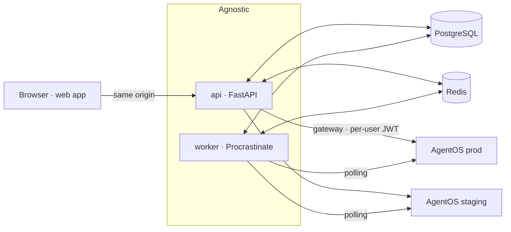

# Architecture overview

Agnostic is a **control plane** for Agno AgentOS. AgentOS is headless: it already serves runs, sessions, memory,
knowledge, traces, approvals, schedules, components and more over REST/SSE. Agnostic doesn't re-implement any of
that; it owns identity, policy, the instance registry, tooling, git sync, cross-instance views and audit, and 
talks to each AgentOS over HTTP.



## Processes

One codebase, one image, two process types:

| Process | Command | Does |
|---|---|---|
| api | `agnostic api` | HTTP API under `/api/v1`, health endpoints, (later) the AgentOS gateway and the built web app |
| worker | `agnostic worker` | background jobs and periodic schedules from every module |
| migrate | `agnostic db upgrade` | one-shot schema migration before a rollout |

`agnostic dev` runs api and worker with auto-reload for development. With SQLite the worker runs inside the API
process ([ADR-019](../adr/0019-sqlite-development-backend.md)).

## Dependencies are endpoints

Agnostic ships only its own artifacts. PostgreSQL, Redis,
object storage, the IdP and the AgentOS runtimes are endpoints the operator configures, each with TLS options.
`agnostic config check --connect` and `/readyz` probe them. The Compose file in `deploy/dev` exists for
contributors only.

## Data ownership

Runtime data (sessions, traces, memories, …) stays in AgentOS. The control plane stores control data (users,
roles, instances, audit, Studio metadata) in the `agnostic` schema, durable jobs in the `procrastinate` schema,
and only ephemeral state in Redis; losing Redis degrades caching and live updates, never correctness.

## Repository layout

```
backend/                 uv workspace (Python 3.15)
  packages/agnostic-kernel/          shared kernel: no business logic
  packages/agnostic-agentos-client/  typed AgentOS 3.1.x client
  modules/hello/                     sample module (removed after P01)
  apps/agnostic-server/              composition root: app factory, worker, CLI
  tests/{unit,integration,contract}/
frontend/                Yarn 4 workspaces (React 19, Vite, Tailwind v4)
  apps/web/              shell: router, sidebar, header, command palette
  packages/ui/           design system (tokens, primitives, patterns) + Storybook
  packages/core/         module SDK, navigation, query defaults
  packages/api/          generated OpenAPI client + TanStack Query options
  packages/testing/      render helpers, MSW handlers
  modules/hello/         sample module page
runtime/                 agnostic-runtime: reference AgentOS (Python 3.13, agno 3.1.12)
deploy/dev/              Compose: PostgreSQL + Redis for development
scripts/                 repository tooling (license policy)
```

## Where to go next

- [Backend kernel](backend-kernel.md) and [module system](module-system.md)
- [Frontend](frontend.md)
- [AgentOS runtime and client](agentos-runtime-and-client.md)
